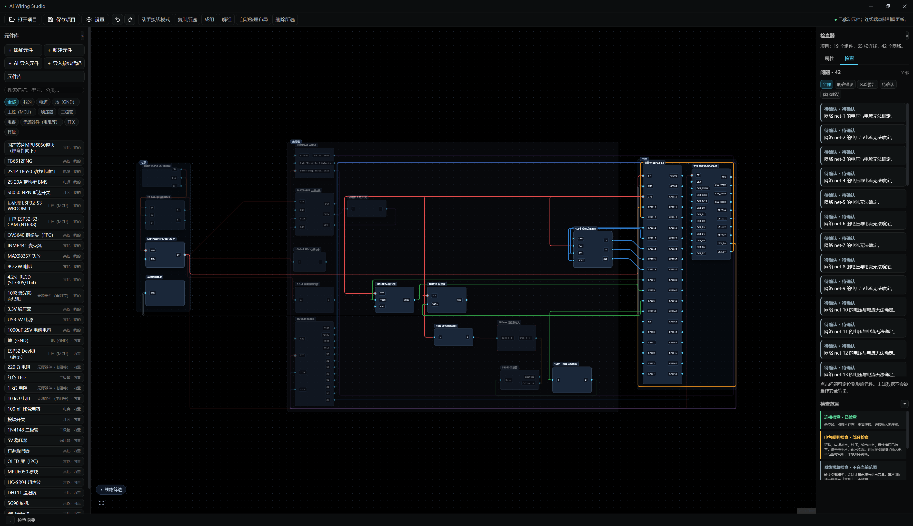

# AI Wiring Studio

**面向电子 DIY 初学者的 Windows 可视化接线工具。**

把 AI 给出的接线方案转成直观的接线图，并按你实际购买的开发板、模块与元件，建立和调整属于自己的元件库。

**⬇ 下载（Windows x64，最新版）**：<https://github.com/YUJUN88888/AI-Wiring-Studio/releases/latest>



- 技术栈：Tauri 2 + Rust（后端）／ React + TypeScript + Vite（前端）／ React Flow（画布）
- 平台：Windows x64
- 版本：0.1.1（早期预览版）
- 授权：源码公开，**仅限非商业使用**（见文末「许可证」）

> 软件只做**规则检查**，不做电路仿真，也不做电流预算估算；算不出来的量一律显示「未知」，绝不猜测。

## 这是什么，为什么做它

作者在**没有任何软硬件基础**的情况下，尝试借助 AI 制作 DIY 电子设备。实践中发现，AI 的文字接线描述往往难以理解：不知道引脚在哪里、不确定该如何连接，对整体线路没有直观概念，实际操作也难以上手。于是通过 AI 辅助开发了这个工具。

本工具主要针对作者使用现有模拟接线工具时遇到的两个问题：

1. **预置元件库与自己实际购买的开发板、模块和元件不一致。**
2. **无法方便地把 AI 给出的接线方案直接转成可视化接线图。**

围绕这两点，当前版本提供的能力是：

- **接线代码导入**：把符合本工具格式的**接线代码（Wiring Code v1，文本格式）**导入，**确定性**地生成可视化接线图；解析失败会给出带行号的中文错误，绝不猜测修改。
- **元件库未收录的元件**：可以连接**你自己的 AI API**，辅助识别并生成**候选**元件资料；候选必须由你逐字段确认后才写入用户元件库。
- **自定义元件**：为元件添加图片、自定义引脚位置，并手动补充和修正引脚及电气参数。
- 项目以 `.aiws`（JSON）文件保存/打开。

本项目源于作者的实际使用需求，会随着 DIY 实践和用户反馈逐步更新完善。目前仍处于**早期预览阶段**，欢迎通过 [Issues](https://github.com/YUJUN88888/AI-Wiring-Studio/issues) 提交问题和改进建议。

### 请先了解这些限制（避免误解）

- **接线方案入口是文本接线代码，不是任意 JSON。** 当前**不支持**直接导入通用/任意 JSON 接线方案；请按下方「快速开始」中的格式编写，或用面板里的「字典」让 AI 生成。`.aiws` 才是 JSON，它用于**项目保存/打开**，不是接线方案导入格式。
- **AI 识别结果只是候选，不保证正确。** 必须由你人工确认；模型无法确认的字段一律返回「未知」，不会用猜测值冒充已知。
- **代码里引用了元件库中没有的元件类型时，导入会报错**（不会自动创建），需要你先收录该元件。
- **不做仿真、不做电流预算。** 见「检查器能力边界」。

## 快速开始：5 分钟生成一张接线图

1. **安装**：从 [Releases](https://github.com/YUJUN88888/AI-Wiring-Studio/releases/latest) 下载 `AI-Wiring-Studio_0.1.1_x64-setup.exe` 并运行（默认装入当前用户目录，无需管理员权限）。
2. 打开软件，在工具栏点开**「接线代码导入」**。
3. 点**「填入示例」**，或把下方示例接线代码粘贴进文本框；也可以用**「选择代码文件」**载入 `.txt` / `.wiring` / `.md` 代码文件。
4. 「导入方式」选**「替换当前画布」**，点**「应用到画布」**。
5. 画布上即生成 3 个元件与 2 根连线；右侧 **ERC 问题检查器**会列出检查结果。
6. 若代码里出现元件库未收录的元件类型，面板会列出「未收录元件」，可点**「用 AI 补查并收录」**，逐字段确认后写入用户元件库（需先在设置里配置你自己的 AI 接口与 API Key）。
7. 满意后用**「项目 → 保存」**存成 `.aiws` 文件；下次打开即可继续编辑。

### 示例接线代码（已实测可导入）

```text
version 1
# 让 AI 按字典写这种代码，粘贴到这里即可生成接线图
component u1 esp32-devkit-demo "主控" at 120,80
component r1 resistor-220r "限流电阻" at 400,80
component d1 red-led "指示灯" at 620,80
wire u1.GPIO21 r1.A
wire r1.B d1.A color #e34b4b
```

> 实测：该示例解析结果为「3 个元件、2 根连线」，且 `wire r1.B d1.A color #e34b4b` 的颜色 `#e34b4b` 被正确识别（行尾的 `#` 不会被误当注释）。

### 让 AI 输出符合本工具格式的接线方案

面板里有一个**「字典」**页签，它会导出「格式规范 + 当前可用元件与引脚」的一段文本。把它连同你的需求一起发给 AI，AI 就知道有哪些元件、哪些引脚、怎样写才会被本工具接受。可直接使用下面的提示词：

```text
你是一名电子接线助手。请严格按下面「字典」给出的格式，输出纯文本接线代码，
除代码与 # 注释外不要输出任何解释性文字。

要求：
1. 第一行必须是：version 1
2. 每个元件一行：component <实例ID> <元件类型> ["显示名"] [at x,y]
   - 元件类型与引脚 ID 只能使用字典里列出的名称；
   - 实例 ID 只能用字母、数字、下划线、连字符，且不含点号。
3. 每根连线一行：wire <实例ID>.<引脚ID> <实例ID>.<引脚ID> [color #rrggbb]
4. 用 # 开头写注释说明你的判断；不确定的地方不要编造引脚，用注释标注「待确认」。
5. 只使用字典中确实存在的引脚；字典里没有的元件类型请在注释中说明，不要臆造。

我的需求：<在这里描述你要做的电路>

字典：
<把「字典」页签里的内容整段粘贴到这里>
```

## 接线代码格式（Wiring Code v1）

| 语法 | 说明 |
| --- | --- |
| `version 1` | 必需，且当前只支持 `1` |
| `component <实例ID> <元件类型> ["显示名"] [at x,y]` | 放置元件；省略坐标时按确定性网格排布（4 列） |
| `wire <实例ID>.<引脚ID> <实例ID>.<引脚ID> [color #rrggbb]` | 连接两个引脚；颜色须为 6 位十六进制 |
| `# …` | 行首 `#` 为整行注释；空行忽略 |

- 实例 ID 只允许 `A-Za-z0-9_-`，且不得含点号；引脚 ID 非空、不含点号与空白。
- 元件类型可用：内置元件类型名（如 `esp32-devkit-demo`）、内置定义 ID（`builtin.*`）、用户元件定义 ID（`user.*`）。
- **未知元件类型会报错**，不会臆造定义；解析失败会给出中文说明与行号，多行错误会累积提示。
- 导入**只创建画布实例与连线，绝不写入用户元件库**；把补查得到的元件写入库，必须由你在面板中显式确认。

## 主要功能

- **画布设计**：元件拖放、引脚级连线、连线途经点、自动走线、缩放与网格。
- **元件库与编辑器**：自建元件定义（引脚、电气参数、封装尺寸、图片）；用户元件库独立于项目文件，可跨项目复用。
- **线路组织**：线路分类（用途）、筛选、聚焦（高亮当前网络）、显示态持久化。
- **电气规则检查（ERC）**：短路、电源冲突、过压、输出冲突、极性错误、电平不匹配、悬空/重复连线、必接输入未连接等，结果按「明确错误 / 风险警告 / 待确认 / 优化建议」四级分类；检查器内如实声明「检查范围」（见下文）。
- **接线代码（Wiring Code v1）**：文本化的接线描述导入/导出，可据此补查缺失元件定义。
- **项目文件**：`.aiws` 项目保存/打开，原子写入 + 自动备份。
- **AI 元件资料导入（可选）**：支持文字描述、型号、网页链接、图片、接线代码补查；AI 输出只作为**候选**，必须经你人工确认为准。
- **外观设置**：界面强调色、画布/连线/元件/界面底色，用户设置优先且可持久化。

## 安装

1. 从 [Releases](https://github.com/YUJUN88888/AI-Wiring-Studio/releases/latest) 下载 `AI-Wiring-Studio_0.1.1_x64-setup.exe`。
2. 运行安装程序（NSIS）；默认安装到当前用户目录，无需管理员权限。
3. 校验安装包完整性：安装包大小与 SHA-256 见 Release 页面（与本仓库 [RELEASE_NOTES.md](./RELEASE_NOTES.md) 一致）。

应用**不需要联网**即可使用除「AI 元件资料导入」以外的全部功能。

## 从源码构建

**环境要求**（下表为实际验证使用的版本）：

| 依赖 | 要求 | 本项目实测 |
| --- | --- | --- |
| Node.js | ≥ 20（建议 LTS） | v24.19.0 |
| npm | 随 Node 附带 | 11.17.0 |
| Rust / cargo | 稳定版工具链 | rustc 1.99.0 / cargo 1.99.0 |
| Windows 构建依赖 | Microsoft C++ 生成工具（MSVC）＋ WebView2 Runtime（Win10/11 通常已内置） | 已具备 |

**依赖安装与开发**：

```powershell
npm ci                 # 按 package-lock.json 精确安装（仓库已提供锁文件）
npm run dev            # 仅前端，浏览器打开 http://localhost:5173
npm run tauri dev      # 启动桌面应用（开发模式）
```

**构建**：

```powershell
npm run build          # 前端产物（tsc -b && vite build）
npm run tauri build    # 生成 NSIS 安装包，产物在 src-tauri/target/release/bundle/nsis/
```

**测试与校验**（下列结果为本仓库实际执行）：

```powershell
npm run lint           # tsc -b 类型检查 → 通过（0 错误）
npm test               # Vitest 单元测试 → 22 个测试文件 / 268 个用例全部通过
npx playwright install chromium   # 首次需下载浏览器（本机已安装 Chromium，未重复执行）
npm run test:e2e       # Playwright 端到端测试 → 75 个用例全部通过
```

以下命令仓库中也已提供，本轮未复核其输出，请按需自行执行：

```powershell
npm run benchmark      # 领域层性能基准（vite-node scripts/benchmark.ts）
cargo test --manifest-path src-tauri/Cargo.toml   # Rust 侧单元测试
```

> 端到端测试覆盖浏览器内的界面流程；依赖 Windows 原生文件对话框的流程（如系统「打开/保存」窗口）未纳入自动化，以人工冒烟为准。

## AI 配置与隐私

- **密钥的存放与流向**：你在设置里输入 API Key 时，密钥会**短暂经过前端输入框与内存**，随即通过 Tauri 调用交给 Rust 后端；保存成功后输入框会被清空。密钥**持久化存储在 Windows 凭据管理器**（由 Rust 侧读写），后续 AI 请求都由 Rust 后端读取密钥并直接发起。此后前端只能查询「是否已配置」，无法再取回密钥明文。
- **不会写入的地方**：密钥不会写入项目文件（`.aiws`）、用户元件库或日志，也不写入前端的持久化存储（前端本地存储只保存接口地址、文字模型、视觉模型这类非密钥设置，并按白名单重建，多余字段会被丢弃）。
- **数据发送范围**：只有在你主动使用「AI 元件资料导入」时，软件才会向**你自行配置的接口地址**发起请求（OpenAI 兼容的 `/chat/completions`）。发送内容仅为你提供的材料：文字描述、型号、网页正文，或图片（以 data URL 形式）。项目结构与用户元件库不会外发。
- **接口地址限制**：真实服务必须使用 `https`；仅本机回环地址（`localhost` / `127.0.0.1` / `::1`）允许 `http`，便于本地网关与测试。
- **错误信息**：调用失败时，错误信息中的密钥会被强制脱敏（替换为 `***`），不会回显。
- **离线可用**：不使用 AI 导入时，应用完全离线运行。

## 检查器能力边界

软件在检查器内如实声明以下五层能力，绝不暗示做过它没做的事：

| 层级 | 状态 | 说明 |
| --- | --- | --- |
| 连接检查 | 已检查 | 悬空线、引脚不存在、重复连接、必接输入未连接 |
| 电气规则检查 | 部分检查 | 短路、电源冲突、过压、输出冲突、极性错误；电平匹配仅在引脚填了输入电平范围时判断 |
| 系统预算检查 | 不在当前范围 | 缺负载模型，无法计算电流与供电容量；算不出的项显示「未知」 |
| 工程建议 | 部分检查 | 仅依据已确认引脚角色的少量条件提醒，不引入通用规则库 |
| 仿真分析 | 不在当前范围 | 只做规则检查，不做电路仿真 |

## 第三方组件

使用的开源依赖及其许可证见 [THIRD_PARTY_NOTICES.md](./THIRD_PARTY_NOTICES.md)。许可证全文收录在 [LICENSES/](./LICENSES/) 目录。安装包内也会随附本项目 `LICENSE` 与 `THIRD_PARTY_NOTICES.md`。

## 许可证

**源码公开，仅限非商业使用。** 本项目采用 [PolyForm Noncommercial License 1.0.0](./LICENSE)。

- 允许：个人非商业使用、学习、研究，以及**非商业**的修改与再分发。
- 禁止：未经书面授权的商业经营、企业业务、收费服务、销售、付费集成或其他商业用途。
- 再分发须保留署名、版权与许可原文（含 `Required Notice:` 行），且不得移除非商业限制。
- 组织用途：按许可原文，慈善、教育、公共研究、公共安全/卫生、环保与政府机构的使用亦被允许。
- 商业授权咨询：请在本项目 GitHub 仓库的 **Issues** 页面发起（<https://github.com/YUJUN88888/AI-Wiring-Studio/issues>）。

> 本项目**不是**符合通常「开源」定义的项目——开源定义不允许限制使用领域，而本项目限制非商业使用。
>
> **请求（非许可条款）**：若你修改并再分发本项目，请在说明中注明所作修改，便于他人辨认来源与差异。此为善意请求，**不构成** PolyForm 许可之外的法律义务。
>
> 第三方组件遵循各自原有许可证（本项目自身的非商业限制**不改变**第三方组件的授权），详见 [THIRD_PARTY_NOTICES.md](./THIRD_PARTY_NOTICES.md) 与 [LICENSES/](./LICENSES/) 目录。